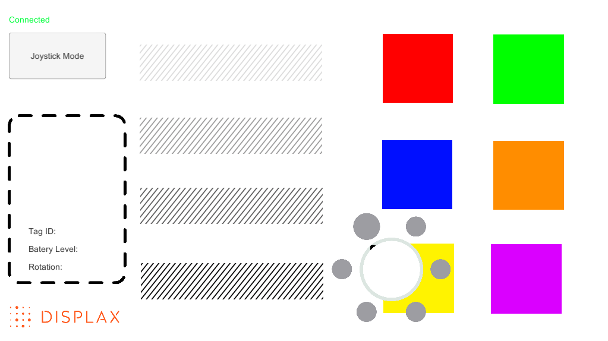
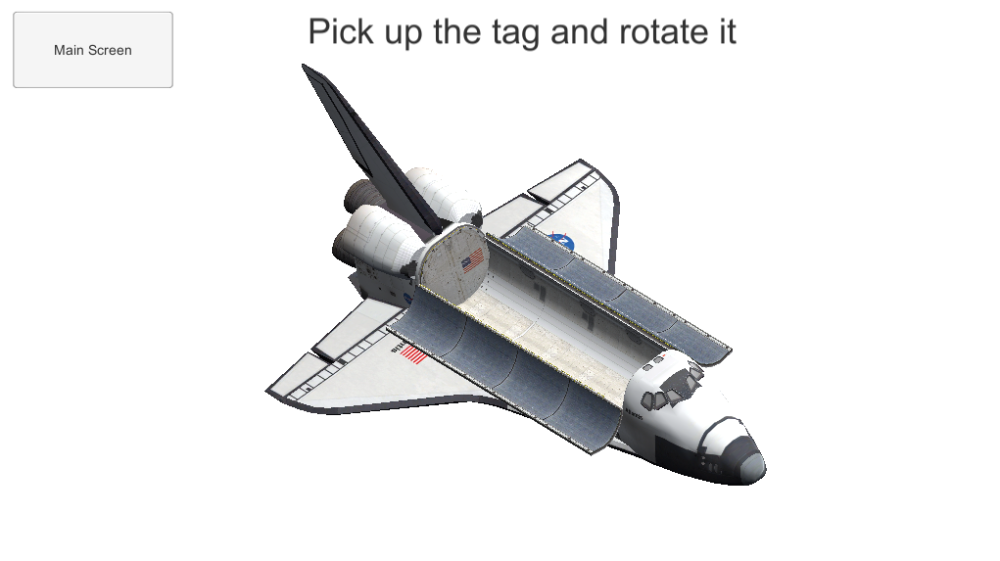

## Example - C# for Unity framework

The example included in this SDK show a simple and basic implementation of DPXActiveOREngine in a Unity app.

For the example to work properly, create an Unity project which base folder is _"CSharp (Unity framework)"_. Next, in"Project" tab, expand "Assets" folder, then "Examples" folder and select the "Scenes" folder. From there, open the scene "DPXActiveOR_Loader.unity". Now, you can run correctly the example._

The loader/init scene, _DPXActiveOR_Loader_, is used to create the persistent objects, namely DPXActiveOREngine.

The main scene, _DPXActiveOR_main_, implements:
- tag info plate - if a tag is placed inside it, it will show some of the DPXActiveTag data.
- vibration Frictioners - "rugged" bars, which will trigger vibration effect actions on the tag. Depending on the "roughness" of the bar, the vibration will be weaker or stronger.
- Color changers - squares of different colors which will trigger a color effect on the tag entering (colliding with) their boundaries. The color effect will vary, depending on the tag object menu selection (see tag prefab below).
- Joystick mode button - change to joystick mode init scene.

The joystick scene, _DPXActiveOR_joystick_, starts with a box and a text requesting to place a single tag inside it. This is a strategy to select and identify the tag to be used as joystick.

After the tag is identified, the box and the text disappears and a space shuttle model is shown. The model x-y-z tilt can be controlled by tilting the tag in the air.

Clicking in normal mode button, it returns to the main scene.

### Tag prefab

This example uses a tag prefab for automatic tag object creation (Check _Examples/Scripts/ActiveTag.cs_). 

The tag prefab, when instantiated, creates a tag object comprised by a circle and a circular menu around it. 

Menu options are selected when the tag is rotated. If the rotation passes from one menu option to another, the activated menu option will be "highlighted", and a tag vibration will be triggered.

The tag menu selection is used to set the color changer effect, when the tag collides with the color changer squares (described above)
