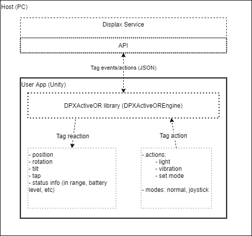
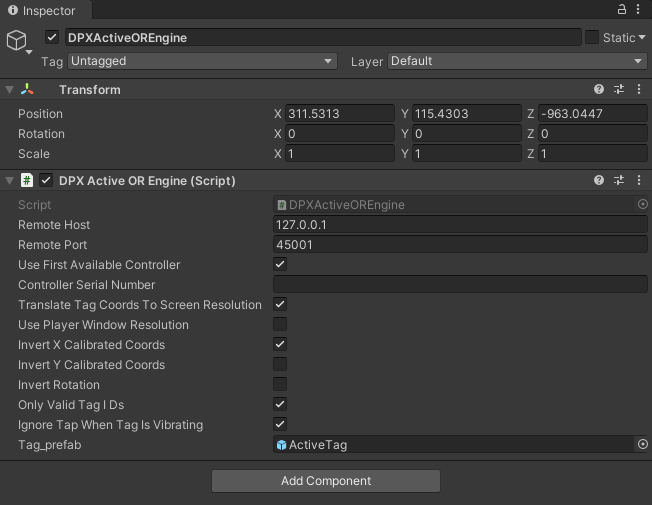

## DPXActiveOR library

This SDK for Unity comprises a set of scripts, located inside the main folder "DPXActiveOREngine" and it's sub-folders.

It abstracts the app developer from all the JSON communication with Displax Service, exposing only two major data flows: tag reactions (generated by the tags/hardware) and tag actions (generated by the apps and sent to the targetted tags).

### How to use DPXActiveOR library

To enable DPXActiveOR in an Unity application:
 - copy the "DPXActiveOREngine" folder (which contains the C# scripts for DPXActiveOR support)  in the target project assets folder
 - create an empty object and assign the script "DPXActiveOREngine.cs" to it.
 - In the Unity inspector/editor, when the created object is selected, a set of variables are available:
    - Remote Host: IP address of host in which the Displax Service is installed (and, typically, the Ultra controller is connected to) - usually, it's the local host, 127.0.0.1
    - Remote Port: Port on which the Displax Service is listening for connection requests (typically, 45001)
    - Use First Available Controller: in the scenario the host has more than one Ultra controller connected to it, the SDK tries to connect to the first one it may find (turned on by default)
    - controller serial number: double check the connection with the right controller, by comparing it's serial number with the one defined here. Empty by default, so it can connects with the first controller available.
    - Invert X Calibrated Coords: depending on the target system orientation, display alignment, etc, this flag may help to configure the right orientation
    - Invert Y Calibrated Coords: depending on the target system orientation, display alignment, etc, this flag may help to configure the right orientation
    - Invert Rotation: depending on the target system orientation, display alignment, etc, this flag may help to configure the right rotation direction (CW or CCW)
    - Only Valid Tag ID's: if a tag is placed on top of the sensor without being paired, activated (for instance, it may not be fully awake, or the pairing process is still going), or has the battery drained (and, thus, not operating/communicating), it can be reported as an "anonymous tag" (with an high value ID, greater than 65535). This flag disable/ignores the reports of such tags to the application.
    - Ignore Tap When Tag is Vibrating: As taps are detected by the internal accelerometer, the haptics vibration motor may trigger it and report a false tap. This flag helps to prevent this, by disabling the tap reports during vibration activity.
    - Tag_prefab: a prefab can be linked here to automate the tag object creation. Otherwise, tag object creation must be handled on tag report event/delegate handlers

    
