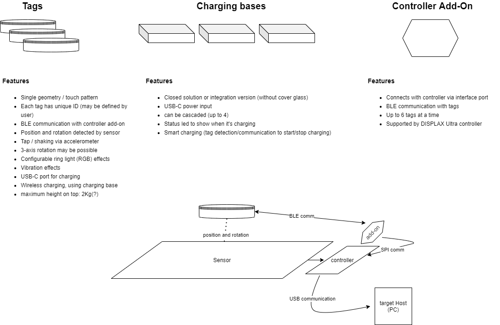
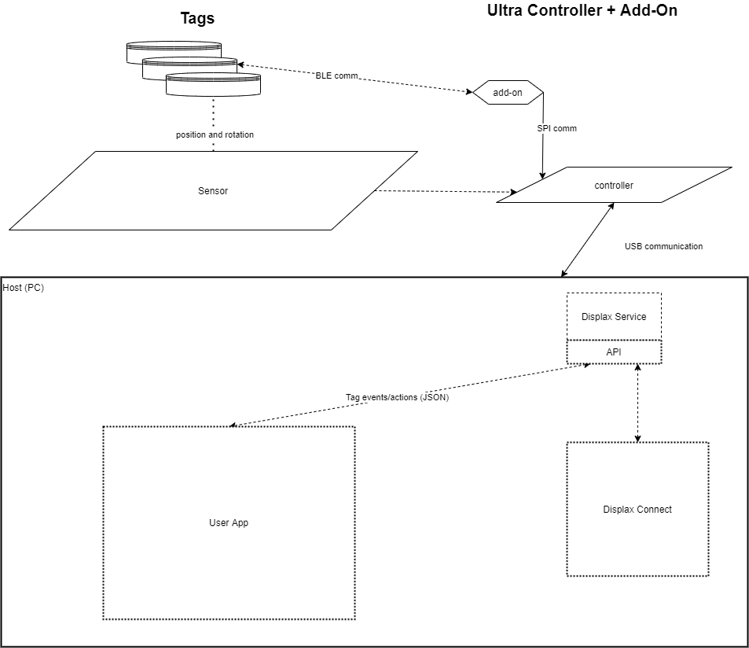

## What is DISPLAX Active OR
DISPLAX Active Object Recognition (DPXActiveOR) solution is a combo of hardware and middleware, which enables interactivity solutions developers to integrate and deliver more than traditional object recognition products. The DPXActiveOR delivers all the typical OR tags can deliver, plus:
- visual feedback (tag ring light)
- haptics (vibration motor)
- tap detection
- joystick mode (to enable the usage of a tag away from the screen. When in joystick mode, the rotation angles around the tag's X, Y and Z axis are available/reported to content/application. See [DPXActiveTag](DPXActiveOR_Classes.md#dpxactivetag) for more details.
- wireless charging (needs DPXActiveOR wireless charger, see below)
- up to 6 simultaneous tags in active mode
- up to 84 tags paired to the system, each one with different ID

## SDK dependencies
### Hardware
- Displax Skin Ultra sensor, with diagonal between 43" and 65", laminated on a glass cover with 4mm thickness (maximum).
- Displax Skin Ultra controller with DPXActiveOR support firmware
- DPXActiveOR add-on module, connected to Ultra controller
- At least one DPXActiveOR tag

### Software
- Displax Connect with DPXActiveOR support (version 3.7 and higher)
- Unity (minimum version: 2019.4.28f1)

## System concepts and communication model

### Hardware highlights
- BLE module identification for tags and add-on comm module
- accelerometer (with tap/shake detection)
- sensor detection sub-circuit
- power management sub-system
- charge/docking solution
- haptics (vibration, RGB led's)

### Communication highlights
 - BT/BLE communication protocol: tag <-> add-on module (transparent to application developer)
 - SPI communication protocol: add-on module <-> controller (transparent to application developer)
 - Tag info (position, tap, rotation, system status) to final application protocol via Displax Service API
 - Tag haptics execution (RGB led's, vibration) protocol: Displax Service API to enable it's use by final applications ( App <-> Host <-> controller <-> tag )
 - Tag haptics configuration (led's patterns, vibration patterns) protocol: Displax Service API to enable it's use by configuration/final applications ( App/ConfApp <-> Host <-> controller <-> tag )
 - Support/Configuration software: integrated in existing support software (Displax Connect)

